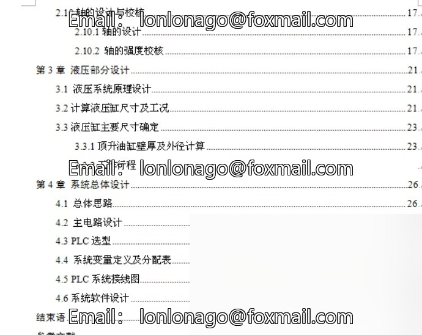
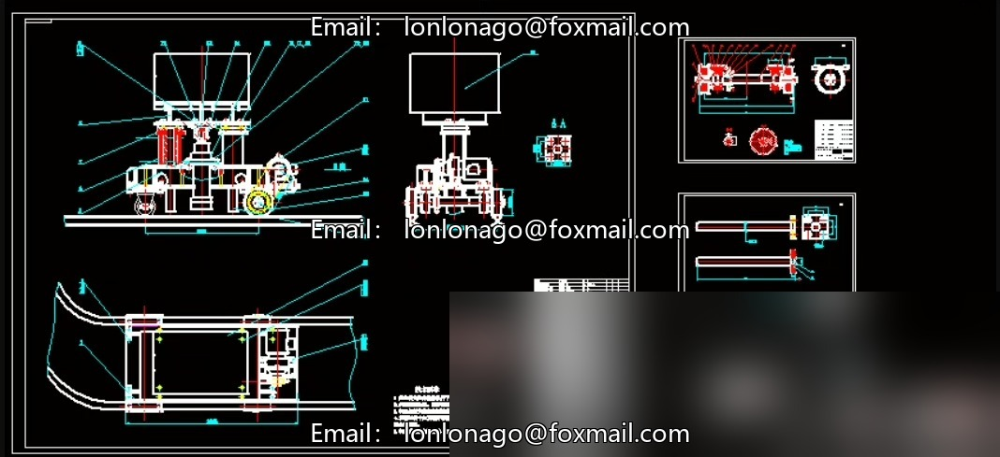
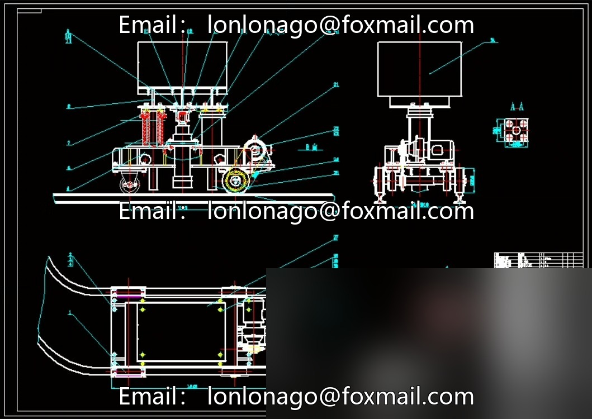

# Feed-Auto-Monitoring Equipment Design for Aquaculture Farms; Design of Automated Feeding Devices for Aquaculture Farms; Aquaculture Field Automated Feeding System

## Body

Design of automatic feed device for breeding farm; design of automatic feed device for breeding farm; design of automatic feed device system for breeding farm; automatic feed design; automatic feed device design drawing; design of automatic feed car.
424 This design achieves automatic feeding of breeding farm by automatic feed car, designs the design of automatic feed device for breeding farm, mainly completes mechanical structure design, and finally designs the control system of the car with PLC control.
The automatic feed car adopts wheel-rail structure, with rounded transition at the car body turning angle.
The power supply of the driving motor for the front wheel of the car is used to drive the feeding motor that pushes materials forward upon opening and closing of the drive signal.
The tail of the car includes a material box, the material box, two motors, and the rear part of the car 4.

The function of the car cargo box is to temporarily store the feed in the car and prepare the feed for the feed inlet motor, with the feed box opening entering the rolling feed box.
The vehicle material box, feed and discharge are added to the feed box according to the function of the material box, then the feeding box, the motor is started, and a slot is fed into the pig pen from the feed box opening.
The purpose of the feeder box is to prevent large fluctuations in the amount fed per round. It is not because the feeding rate is affected by different pig growth, and the separate design can better reduce food waste and improve the feeding process to save costs.
The front wheels of the car only serve an auxiliary function, without power.

The design uses an automated feeding trolley to feed livestock in a farming area, covering mechanical structure, PLC control and hydraulic system design, with accompanying drawings and documents.

<!-- AI_ENRICHED -->

## Images

## Payment

Here is a pay link on Stripe ( https://buy.stripe.com/3cs8yP7sY87d0vu9AB ). Please contact me lonlonago@foxmail.com after funding $89, and I will send you a complete data files , thank you!

